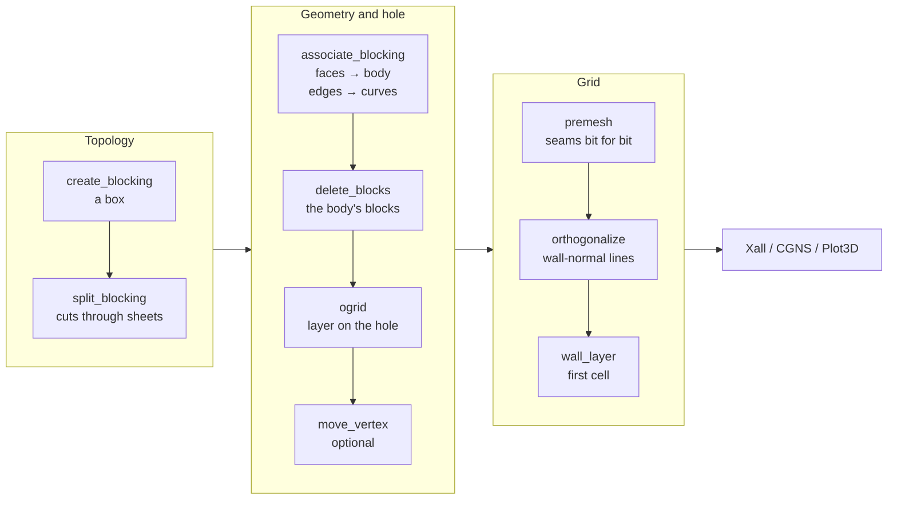

# Blocking

Blocking is how a multi-block topology is made by hand, in the style of
ICEM CFD: start from a box round the geometry, cut it, remove the blocks
the body occupies, wrap an O-grid round the hole, associate faces, edges
and vertices with the geometry, then mesh. Every other SHORE mesh comes
from a builder (a topology, a primitive, a collar); a blocking is a
topology of the user's own, for any body, through journaled commands that
replay after a geometry edit.



## Skeleton and premesh

A **blocking** holds no grid nodes. It is a skeleton:

- **points**: the skeleton vertices;
- **blocks**: a label and 8 vertex ids each, in `HexBlock.vertices()`
  order, vertex index $4i + 2j + k$ for corner $(i, j, k) \in \{0, 1\}^3$.
  Blocks that touch share vertex ids, so a face or an edge is *one entity*
  in every block that has it;
- **nodes**: a node count per edge. The four parallel edges of a block
  always share their count;
- **associations** keyed by entity: `("v", id)`, `("e", a, b)` with
  $a < b$, `("f", a, b, c, d)` sorted.

Commands edit the skeleton (`Project.blocking` is the current
component's). **Premesh** turns it into ordinary `HexBlock`s and replaces
the component's mesh, so the rest of the pipeline (snap, redistribute,
quality, Xall, CGNS, the GUI) works unchanged. The blocking is not stored
apart from the journal: replay rebuilds it, and a project loaded without
replay has its mesh but no blocking. Spacing laws are not set on blocking
edges; use `redistribute` after premesh.

Entity names are those of a `HexBlock`: faces `i_lo` … `k_hi`; edges named
by the two faces they lie on, e.g. `j_lo_k_lo` (an i edge); vertices `v0` …
`v7`.

<Figure name="blocking-skeleton" caption="The wing–body blocking before premesh: skeleton edges and block-centre markers; the hole round the body is visible." />

## Editing

### Create

`p.create_blocking(ni, nj, nk, *, geometry="body", margin=0.0, vmin=None,
vmax=None)`: one block `b0` of `ni × nj × nk` nodes, either the bounding
box of a geometry with each side moved out by `margin` × the box's extent
along that axis, or the box between `vmin` and `vmax`.

### Split

`p.split_blocking(block, axis, fraction)` cuts at node
$m = \mathrm{round}(\text{fraction} \cdot (n - 1))$, which must be
interior, so node counts stay integers. The new vertices lie on the
straight skeleton edges. The cut is carried through every block sharing a
cut edge, the whole **sheet**, at the same node. Carrying it through
shared edges, not only shared faces, keeps the blocking conforming where
blocks meet only along an edge. A cut that would reach an edge twice, or
a block along two axes or at two nodes, is refused.

The low part keeps its label; each high part gets `b<n>`, with $n$
counting up over the blocking in block order, so labels are deterministic
on replay. Associations of cut edges and faces pass to both halves.

### Delete

`p.delete_blocks(labels)` removes blocks; the faces they leave become
boundary faces. A lattice with its centre deleted is the usual start of an
external blocking.

### O-grid

`p.ogrid(blocks=(), *, faces=(), exclude=(), factor=0.5, nodes=5)` puts a
layer of blocks on faces of a block set $S$ (`blocks`, or every block).
The layered faces $W$ are `faces` (`(block, face)` pairs), or the
boundary faces of $S$ (faces of an $S$ block not shared with another)
less `exclude`.

- Every vertex $v$ of a layered face gets an inner copy

  $$
  v' = v + (1 - \text{factor})\,\tfrac12 \sum_{e} \mathbf e,
  $$

  summed over the distinct **across edges** at $v$: edges of $S$ blocks
  that leave a layered face at $v$ into their block.
  - Inside one block these are its three edges at $v$, so the core is the
    block scaled by `factor` about its centre (ICEM's factor).
  - Between two blocks in a row, the middle vertices move only across, so
    the shared face stays plane.
  - At the faces of a hole the across edges point away from the hole, and
    the layer grows into the blocks round it. (Moving $v$ towards the mean
    centroid of its blocks was rejected: it cancels at a hole corner.)
- The $S$ blocks take the copies and keep their labels; each layered face
  gets a layer block (`b<n>`, in block and face order) between itself and
  its copy, with the face's counts along it and `nodes` across.
- Boundary faces of $S$ that are not layered stay **open**: the layer
  passes through them and the copies on them stay in their plane. That is
  the half-O at a symmetry plane.
- Associations: a layered face keeps its own, now on the layer's outer
  face; a face or edge replaced by the copies passes its association on;
  an open face also passes it to the layer faces lying on it.

**Refused** (project and journal unchanged): `factor` outside $(0, 1)$;
`nodes` < 2; an unknown block; a face not on the set's boundary; a face of
the set that touches the layer but is shared with a block outside the set
(the blocking would stop conforming: add that block to the set or layer
the face); no face left to layer; a layer of zero thickness at a vertex.

<Figure name="blocking-ogrid" caption="O-grid insertion: a block set before and after, with the layer blocks round the core." />

Round the unit sphere (a lattice of $[-3, 3]^3$ cut at ±1, centre
deleted), the largest angle between a wall node's first grid segment and
the sphere's normal falls from 40.8° (26 blocks) to 5.7° with a hole
layer at factor 0.5 (32 blocks), minimum scaled Jacobian 0.44. O-gridding
the centre block itself and deleting its core works only when the centre
box is larger than the body: at ±1 round the unit sphere the core's faces
project onto the sphere and the grid inverts. Layering the hole's faces
has no such limit.

### Move a vertex

`p.move_vertex(block, vertex, xyz)` moves one skeleton point; every block
having it follows. An associated vertex (own or inherited association)
is stored at the projection of `xyz` onto its geometry, so it slides on
it, and replay after a geometry edit re-projects it. Moves are not
checked for validity: intermediate states may be invalid, and premesh
quality is what counts.

### Associate

`p.associate_blocking(block, entity, geometry="body", kind="body",
indices=())` associates a face, edge or vertex with a geometry entity
(`body`, `surface`, `curve`, `point`, or `none` to clear), validated like
`associate` on mesh blocks (see [Association](/concepts/association)).
Curves are CAD edges, or STL feature curves (edges sharper than 30° and
open boundaries).

**Inheritance.** An entity without its own association takes one from the
entities above it, lowest dimension first, when they agree:

- an edge, from its associated faces;
- a vertex, from its associated edges, else from its associated faces.

Associating the six faces of a hole with the body is enough: the hole's
edges and corners follow. Inheritance is evaluated at premesh time, so it
always follows the current associations. An edge between two faces
associated with *different* geometry stays straight until it gets an
association of its own: the nearest point of two surfaces is not their
intersection curve. A wing–body junction is such an edge; associate it
with the junction curve.

## Premesh

`p.premesh(exact=False)`:

1. **Vertices** are projected onto their associations.
2. **Edges**, each computed once: equally spaced nodes on the straight
   line between its vertices; if associated, projected and
   re-equidistributed along the projected polyline (three passes), then
   projected once more.
3. **Faces**, each computed once: a Coons patch (TFI) of its four edges,
   the interior then projected onto the face's association.
4. **Blocks**: a TFI of their six faces.

Edges and faces are copied into every block that has them, oriented by
the corner permutations, so **seams match bit for bit** (gap 0). Faces
shared by two blocks become SHARED seams, with axis maps from the corner
ids; boundary faces are **WALL** when associated (own or inherited) and
**FREE** otherwise. The blocks carry the associations, so a `snap` after
premesh moves nodes by round-off only. The mesh is not marchable.

`exact` selects the CAD projection tier. With `exact=False` (tier 1)
projection is onto the CAD model's tessellation, with $(u, v)$ and normals
interpolated: fast, within a couple of tessellation deflections near the
surface. With `exact=True` (tier 2) each point is projected by Newton
iteration onto the exact face or edge. On the wing–body model, tier 1
left wall nodes on the junction up to $4 \cdot 10^{-3}$ off the body,
because the CAD edge's tessellation and the faces' do not coincide; tier 2
puts them within $10^{-9}$. An STL's facets are its geometry, so `exact`
changes nothing there.

<Figure name="blocking-premesh" caption="The premeshed blocking: the wall grid on the body and the grid on the symmetry plane." />

Premesh quality is TFI's. Round a smooth body, the lines leave the wall
along the blocking, not the normal: about 35° median on a wing on a plane
(ADR 0046). Placing the wall nodes differently cannot fix that (ADR 0047
tried projecting walls from across the block: nodes crowd at sharp edges,
or the angles return). The interior has to move, which the next two
commands do.

## Wall-normal lines

`p.orthogonalize(strength=1.0)` reshapes, in every block with exactly one
WALL face, each grid line across the wall into a cubic Hermite curve
from the wall node $\mathbf w$ to the opposite node $\mathbf o$:

$$
\mathbf x(s) = h_{00}(s)\,\mathbf w + h_{10}(s)\,\mathbf T_0
+ h_{01}(s)\,\mathbf o + h_{11}(s)\,\mathbf T_1,
\qquad
\mathbf T_0 = \text{strength}\;\lvert\mathbf o - \mathbf w\rvert\;\hat{\mathbf n},
$$

with $h_{\cdot\cdot}$ the cubic Hermite basis, $\hat{\mathbf n}$ the wall
normal and $\mathbf T_1$ the chord length times the line's old direction
at $\mathbf o$. The nodes keep their arc-length fractions (64 samples per
curve); the wall and the opposite face do not move.

- **Normals** come from the wall grid itself (cross product of its
  tangents), not from STL facets, which are piecewise constant. Each wall
  node's normal is the mean over every wall face holding it, keyed by the
  node's exact coordinates: blocks sharing a node share its normal and
  build shared faces identically, so seams stay closed.
- **Neighbours** without a wall whose faces moved are re-filled by TFI.
- **Refusal.** If a block that was valid would invert, nothing changes;
  lower the strength.

At a **concave junction** (wing on fuselage) a node shared by both walls
gets the mean of their normals, the bisector. With strength 1 the wing's
side layers at the junction invert and the command is refused; the
wing–body acceptance uses 0.5. At sharp edges (TE, tip) one block per wall
face cannot follow two normals, and lines stay near 45°.

Followed by `redistribute`, nodes stay on the reshaped lines.

## Wall layer

`p.wall_layer(first_step)` redistributes the nodes on every line across
the wall of each block with one WALL face: geometric cells from the wall,
the first exactly `first_step` long (an absolute length), the ratio $r$
of each line from its own length $L$ and node count $n$:

$$
\Delta s_0\,\frac{r^{\,n-1} - 1}{r - 1} = L .
$$

Nodes are placed on the line's own polyline, so after `orthogonalize` they
stay on the wall-normal curves. A first step not below a line's uniform
spacing $L/(n - 1)$ is refused. Each line is solved on its own, with
sequential sums, so a line shared by two blocks gets the same bits in
both and seams stay closed.

<Figure name="wall-layer" caption="The wall layer at the wing–body junction: first cell 2e-3, wall-normal lines." />

A wall layer needs a layer topology (an O-grid round the body). On a bare
lattice the clustered side faces are shared with edge and corner blocks
that have no wall; their TFI between differently spaced faces inverts
them, and the command is refused.

`premesh → orthogonalize → wall_layer` is the algebraic counterpart of a
marched wall layer. Round the sphere's hole layer it gives first cells of
$10^{-3}$ with wall angles below 2°; on a wing on a plane, first cells of
$10^{-4}$ with a median wall angle of 3.3°.

## Example

The 26-block lattice round a unit sphere, its hole O-gridded, premeshed
and given a wall layer:

```python
import trimesh

from shore.project import Project
from shore.quality import scaled_jacobian

trimesh.creation.icosphere(subdivisions=4).export("sphere.stl")  # unit sphere

p = Project()
p.load_geometry("sphere.stl")  # geometry "body"
p.create_blocking(13, 13, 13, vmin=(-3, -3, -3), vmax=(3, 3, 3))
for axis in "ijk":
    p.split_blocking("b0", axis, 1 / 3)  # cut at -1, carried through the sheet
p.split_blocking("b1", "i", 0.5)  # cut at +1
p.split_blocking("b2", "j", 0.5)
p.split_blocking("b4", "k", 0.5)  # 27 blocks; b7 is the centre [-1, 1]^3
for face in ("i_lo", "i_hi", "j_lo", "j_hi", "k_lo", "k_hi"):
    p.associate_blocking("b7", face)  # with the body
hole = [("b5", "i_hi"), ("b11", "i_lo"), ("b6", "j_hi"),
        ("b16", "j_lo"), ("b3", "k_hi"), ("b23", "k_lo")]  # fmt: skip
p.delete_blocks(["b7"])
p.ogrid(faces=hole, factor=0.5, nodes=17)  # 32 blocks
p.premesh()
p.orthogonalize(strength=1.0)
p.wall_layer(1e-3)
print(len(p.mesh.blocks), min(scaled_jacobian(b.nodes).min() for b in p.mesh.blocks))
# 32 0.438...
```

The hole faces are named by the blocks round the centre. The faces were
associated through the centre block before it was deleted; the
association belongs to the face entity, which the neighbours share.

## Phase-7 acceptance: a wing–body half model

The acceptance of the blocking work (ADR 0051) is a wing–body blocking
built interactively and replayed from its journal after a CAD edit:

- **Model** (build123d, STEP): a capsule fuselage along x (radius 0.5,
  cylinder length 5) and a blunt-TE NACA 0012 wing (chord 1) along +z to
  z = 3, fused; a half model on the plane z = 0; 8 faces, 17 edges.
- **Blocking**: box $[-6, 7] \times [-4, 4] \times [0, 6]$ with
  53 × 33 × 25 nodes, cut at x = −3, −0.3, 1.3, 3, y = ±0.8, ±0.3,
  z = 0.8, 3.3; the 25 faces bounding the 10 blocks round the body
  associated with it; the 4 edges at the base of the wing's block
  associated with the 3 junction edges; those 10 blocks deleted; an
  O-grid on the 25 hole faces (factor 0.7, 17 nodes across);
  `premesh(exact=True)`; `orthogonalize(0.5)`; `wall_layer(2e-3)`.
- **Edit**: span 2.7, fuselage radius 0.55; the journal is replayed on the
  edited model.

| | Original | Edited, replayed |
|---|---|---|
| blocks | 90 | 90 |
| minimum scaled Jacobian | 0.17 | 0.135 |
| seam gap | 0 | 0 |
| wall nodes off the body (exact) | $9.5 \cdot 10^{-10}$ | $2.5 \cdot 10^{-9}$ |
| first cells | $2 \cdot 10^{-3}$ | $2 \cdot 10^{-3}$ |
| wall angle median / p95 (away from plane, TE, tip, junction) | 9.0° / 25.3° | 9.5° / 26.4° |
| junction ring on the junction curves | $< 10^{-8}$ | $< 10^{-8}$ |

Before `orthogonalize` the wall angle was 24.7° median, 68.6° p95.
Without the junction associations no wall node lands on the junction.
The same blocking built through the GUI replays headless bit for bit.

## Limits

Recorded by ADR 0046–0051:

- **Half model, edits inside the hole.** The edit must keep the body
  inside the blocking's hole; a longer span would pierce the wing's
  block. Blockings that adapt to edits leaving the hole, full-span and
  multi-component models are open.
- **Concave junctions** need `orthogonalize` below strength 1.
- **Sharp edges** (TE, tip) keep wall angles near 45°: a block per wall
  face cannot follow two normals; that needs a cut at the edge.
- **Algebraic wall layers.** Hyperbolic marching of a blocking's wall
  patches needs a general seam-aware multi-patch marcher; deferred. There
  is no growth-ratio limit: the ratio follows from the line's length and
  node count.
- **One wall per block.** `orthogonalize` and `wall_layer` act only on
  blocks with exactly one WALL face.
- **No interior smoothing.** 3-D elliptic smoothing of the blocks is not
  implemented.
- **Projection from inside collapses.** O-gridding a block that lies
  inside a thin body (a core inside a wing) projects its faces onto the
  nearest side, never round the LE or TE; layer the hole's faces from
  outside instead.
- **Not implemented**: merge, collapse, mouse drag of vertices, moving
  several entities at once, rubber-band selection in the GUI.

## See also

- ADRs: [0042 — Skeleton and premesh](/adr/0042-blocking-skeleton-premesh),
  [0043 — O-grid insertion](/adr/0043-ogrid-insertion),
  [0044 — Selection](/adr/0044-blocking-selection),
  [0045 — Vertex moves](/adr/0045-move-blocking-vertex),
  [0046 — Wing investigation](/adr/0046-wing-blocking-investigation),
  [0047 — Walls from outside, rejected](/adr/0047-walls-from-outside-rejected),
  [0048 — Wall-normal lines](/adr/0048-orthogonal-wall-lines),
  [0049 — STL feature curves](/adr/0049-stl-feature-curves),
  [0050 — Wall layer](/adr/0050-wall-layer),
  [0051 — Wing–body acceptance](/adr/0051-wing-body-acceptance).
- API: [`shore.mesh.blocking`](/reference/api/shore.mesh.blocking)
  ([`Blocking`](/reference/api/shore.mesh.blocking#Blocking),
  [`ogrid`](/reference/api/shore.mesh.blocking#ogrid),
  [`premesh`](/reference/api/shore.mesh.blocking#premesh)),
  [`shore.mesh.orthogonal`](/reference/api/shore.mesh.orthogonal),
  [`Project.ogrid`](/reference/api/shore.project.project#Project-ogrid),
  [`Project.premesh`](/reference/api/shore.project.project#Project-premesh),
  [`Project.orthogonalize`](/reference/api/shore.project.project#Project-orthogonalize),
  [`Project.wall_layer`](/reference/api/shore.project.project#Project-wall_layer).
- [Blocking tutorial](/tutorials/blocking), [GUI tutorial](/tutorials/gui),
  [Blocking recipes](/cookbook/blocking), [`shore run`](/reference/run).
- [Block model](/concepts/block-model), [Association](/concepts/association),
  [Geometry](/concepts/geometry), [Grid quality](/concepts/quality).
