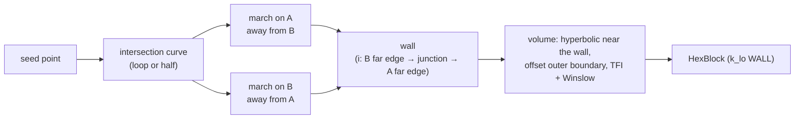

# Collar blocks

A Chimera collar is a volume block wrapped round the junction of two
components: a wing root on a fuselage, a strut on a plate, an appendage
on a hull. The body grids of the two components cannot resolve the
concave corner where they meet; the collar does, and overlaps both.
SHORE builds it from three kernels:



`shore.collar.build_collar(body_a, body_b, seed, *, n_loop, steps_a,
steps_b, steps_k)` returns one `HexBlock` of
`(len(steps_b) + len(steps_a) + 1, n_loop, len(steps_k) + 1)` nodes. The
collar is `sum(steps_k)` thick. `shore collar` and
`Project.build_collar` wrap it and build the steps as
`ds_surface * growth_surface**j` (`m_a` of them on A, `m_b` on B) and
`ds_wall * growth_wall**k` (`nk` of them).

<Figure name="collar" caption="A collar block at a wing–fuselage junction: the wall on both bodies and one j-slice of the volume." />

## The wall

- **j** runs along the junction curve ([Intersection
  curves](/concepts/intersection-curves)): periodic for a closed collar, as
  in an O-grid.
- **i** runs from B's far edge, through the junction row at
  `i = len(steps_b)`, to A's far edge. Each side is a surface grid marched
  away from the other body ([Surface marching](/concepts/surface-marching)).
- **k** leaves both walls; `k_lo` is WALL, the other faces FREE.

The wall is creased along the junction row, typically at 60–120°. That
crease is what makes the volume hard.

## The volume

Plain hyperbolic extrusion folds every junction, always in the three rows
next to the crease, and always once the layer thickness $d$ reaches the
junction's surface spacing $h$. The reason is geometric: at a 90° concave
crease, the junction node offsets to $(d, d)$ and its neighbour on the
floor to $(h, d)$, so the cell between them has width $h - d$, which
vanishes at $d = h$. Any scheme that keeps the grid lines orthogonal at
the crease folds there; a grid survives a concave corner by splaying.

So the volume is built in four steps:

1. **Near-wall layers** by the hyperbolic volume kernel, while they are
   thinner than half the junction spacing (`hyperbolic_fraction` 0.5;
   $h$ is the smaller first surface step on either side), where they
   cannot fold.
2. **Outer boundary.** The last near-wall layer is offset by the remaining
   thickness. At the concave junction the offset forms a swallowtail; it
   is trimmed at its self-intersection, and the nodes are placed by arc
   length with the trimmed crease mapped onto the junction row.
3. **Interior** by TFI between the near-wall layer and the outer boundary,
   using the k schedule.
4. **Winslow smoothing** per loop station with Thomas–Middlecoff control
   functions (as in [Surface grids](/concepts/surface-grids)), which keeps
   the wall clustering. It is solved by Picard iteration with one SuperLU
   factorisation per step for all stations and coordinates at once,
   converged to $10^{-12}$ of the collar thickness.

On the four analytic junctions of the acceptance spec (64 loop nodes,
15 surface rows $0.01 \cdot 1.12^j$ per side, 30 wall-normal layers
$10^{-4} \cdot 1.2^k$, a collar 12 junction spacings thick) there are no
folded cells; the minimum scaled Jacobian is 0.08 on the tilted plane
(63–74° junction) and 0.49–0.66 on the others; the first cell is within
1.6 % of `steps_k[0]` and the outer layer within 0.3 % of the thickness.
Each collar takes about 2 s.

### Outer boundary: `smoothed` and `stations`

`CollarParams.volume` selects the outer-boundary construction.

| | `"stations"` (original) | `"smoothed"` (default) |
|---|---|---|
| per station | i-line offset in its best-fit plane | i-line offset as a 3-D polyline; the swallowtail found in the best-fit plane, its crossing the midpoint of the two 3-D crossing points |
| along the loop | stations independent | offsets smoothed along the loop by a Gaussian of 0.5 × the thickness, one kernel for all i, only near corners at the collar's scale (the loop turns by 60° or more within ± one thickness) |
| repair | — | where the outer boundary advances along the loop by less than 0.5 of the inner row, local 1-2-1 smoothing; then each station is trimmed again |

Station-by-station construction fails at loop corners: one station alone
cannot fan round a convex corner, nor stop crossing its neighbour at a
concave one, once the collar is thicker than the loop spacing. On 49 test
junctions (rectangles, L-shapes, blunt wings, split collars, at 1.9 to 11.8
junction spacings), the folded cells outside a folded wall fall from 2367
(`stations`) to 72 (`smoothed`). Smoothing is restricted to corners
because smoothing everywhere shortens offsets whose directions rotate on a
smooth curved loop (1.4 % of the envelope on cylinder × cylinder).

Projects saved before format 3 replay their collars with `"stations"`, so
their grids still match on load. To reproduce an old grid outside a
project use `CollarParams(volume="stations")` or
`--collar-volume stations`.

## Half-collars on a symmetry plane

With `plane=(point, normal)`, `build_collar` traces the open junction
curve of a half model, marches both halves with their ends on the plane,
and returns an open block (`periodic_j` false) whose `j_lo` and `j_hi`
faces lie on the plane with `FaceBC.SYMMETRY` (written to `cc.par` as
natural-BC code 2).

The volume is the half of the closed collar built on the **mirrored
wall**: the wall is reflected across the plane into a closed wall of
$2(n_\text{loop} - 1)$ stations, extruded with the same volume stage
(`extrude_collar`), and the first $n_\text{loop}$ stations are kept, their
j-faces put exactly on the plane. The cost is extruding twice the
stations; the benefit is the accepted volume kernel unchanged, and a
result that is the symmetric solution by construction. On the spec's half
models the j-lines are within 0.12° of the plane normal.

When the curve meets the plane obliquely (end tangent more than 1° off
the plane normal, `oblique_deg`), the bodies are not mirror-symmetric
there and `build_collar` warns: the mirrored wall is then not a valid
surface and the block's quality is not guaranteed.

## Corners and the split collar

Junctions through edges (trailing edges, struts) have corner nodes. What
the single block can do there:

| Junction (96 loop nodes, $h$ = first surface step) | Single block |
|---|---|
| convex 90° (rectangular strut) | valid up to about 4.7 $h$ thick (1.9 $h$ with `loop_curvature` 1) with `stations`; much thicker with `smoothed` (11.8 $h$: 0 folds) |
| concave 90° (L-shape) | a few folded cells from about 5 $h$ thick, even with `smoothed` |
| blunt trailing-edge base | valid wall; 2–15 folded volume cells at 96 loop nodes |
| sharp corner, > 105° (sharp TE, lens tip) | the **wall** folds: the surface grid cannot fan round the turn |

Sharp corners need a different topology. `shore.collar.split_collar`
(`Project.build_collar(split=True)`, `shore collar --split`) takes the
C-grid's wake cut to the collar:

- **Cut.** The loop is cut at each tracer corner turning by more than
  105° (`sharp_deg`).
- **Wake.** Each piece is extended at both ends by a wake line on A,
  along the bisector of the corner's two loop directions, with cells
  starting at the corner's loop spacing and growing by at most 1.2
  (`wake_ratio`) up to `wake_length` (default: the collar's width on A,
  `sum(steps_a)`).
- **Sheet.** Over the wake the wall is a virtual sheet: the corner's grid
  line on B translated along the wake. B is marched with its two ends
  held on the two sheets. The sheets of neighbouring pieces are joined by
  a SHARED seam (`k_lo` to `k_lo`, i same, j reversed), as at a C-grid
  wake cut.
- **Blocks.** Each piece is extruded as one open block and split at the
  junction row and at its two corners into six blocks,
  `{label}_{piece}_{wake_lo|body|wake_hi}_{b|a}`.

The front on A then turns by half the wedge angle (8° on a NACA 0012 TE)
instead of 164°. On the sharp-TE STL wing at 1.9 $h$ the single block
folds 12 cells (5500 with curvature 1); the split collar's minimum scaled
Jacobian is 0.155 (0.228). Without sharp corners `split_collar` returns
`build_collar`'s block, bit for bit.

## Parameters

`CollarParams` (defaults; not per-case tuning knobs):

| Field | Default | Meaning |
|---|---|---|
| `hyperbolic_fraction` | 0.5 | hyperbolic layers while thinner than this × $h$ |
| `max_iterations` | 400 | Winslow Picard steps |
| `tolerance` | 1e-12 | largest node update, relative to the thickness |
| `control_limit` | 1.5 | bound on the control functions |
| `oblique_deg` | 1.0 | half-collar warning threshold |
| `sharp_deg` | 105 | split collar: corners turning more are cut |
| `wake_ratio` | 1.2 | split collar: largest ratio of adjacent wake cells |
| `volume` | `"smoothed"` | outer boundary: `"smoothed"` or `"stations"` |
| `offset_smoothing` | 0.5 | Gaussian width along the loop, × thickness |
| `backstep_ratio` | 0.5 | outer row advances at least this × the inner |
| `backstep_iterations` | 200 | local repair passes |

The choices that matter are the user's: `n_loop` and the loop
distribution (`loop_spacing`, `loop_curvature`; try curvature 1 on rounded
sections), the surface steps (the collar's width on each body), and
`steps_k` (first cell and thickness).

## Example

```python
import numpy as np

from shore.collar import build_collar
from shore.geometry.stl import StlGeometry
from shore.quality import scaled_jacobian
from shore.shapes import cylinder, sphere

ball = StlGeometry(sphere(radius=1.0, subdivisions=4))
post = StlGeometry(cylinder(radius=0.4, height=3.0, sections=64))
steps = 0.01 * 1.12 ** np.arange(15)

collar = build_collar(
    ball, post, np.array([0.4, 0.0, 0.9]),
    n_loop=64,
    steps_a=steps, steps_b=steps,
    steps_k=1e-4 * 1.2 ** np.arange(30),  # 0.118 thick
)
print(collar.nodes.shape, scaled_jacobian(collar.nodes).min())  # (31, 64, 31, 3), about 0.74
```

## Limits

- **Thick collars at sharp junctions** (well over 12 junction spacings at
  junctions sharper than 90°) fold; the tilted-plane prototype folded
  1203 cells at 32 spacings.
- **Concave corners and notches.** A few cells fold from about 5 junction
  spacings. If the march on A runs deeper into a concave notch than the
  notch is wide, the surface grid bunches at the bisector and the volume
  folds there: keep the collar's width on that body small. At 96 loop
  nodes such collars are valid up to 1.9 junction spacings thick.
- **Extreme clustering.** With strong curvature clustering at corners
  (192–384 loop nodes), walls are valid but volumes fold when the collar
  is 100–300 × thicker than the corner spacing. Keep the collar thinner
  than about 10 × the smallest loop spacing at corners, or cluster less
  there.
- **Split collars**: no half-collars with sharp corners; a sharp corner on
  an edge of A raises.
- **No body association.** The collar's wall lies on two bodies, so the
  block carries none; `snap` does not apply to it.
- **Two planes**: half-collars end on one symmetry plane only.

## See also

- ADRs: [0010 — Collar block](/adr/0010-collar-block),
  [0013 — Half-collar](/adr/0013-half-collar-block),
  [0018 — CLI and projects](/adr/0018-cli-collars-and-projects),
  [0024 — Split collar](/adr/0024-split-collar-at-sharp-corners),
  [0025 — Volume at corners](/adr/0025-collar-volume-at-corners),
  [0026 — Smoothed by default](/adr/0026-smoothed-collar-volume-by-default),
  [0028 — Extreme clustering](/adr/0028-collar-volume-at-extreme-clustering).
- [`shore.collar`](/reference/api/shore.collar) —
  [`build_collar`](/reference/api/shore.collar#build_collar),
  [`split_collar`](/reference/api/shore.collar#split_collar),
  [`extrude_collar`](/reference/api/shore.collar#extrude_collar),
  [`CollarParams`](/reference/api/shore.collar#CollarParams);
  [`Project.build_collar`](/reference/api/shore.project.project#Project-build_collar).
- [`shore collar`](/reference/collar) (CLI), [Collar tutorial](/tutorials/collar),
  [Half models](/cookbook/half-models).
- [Chimera grids](/concepts/chimera).
