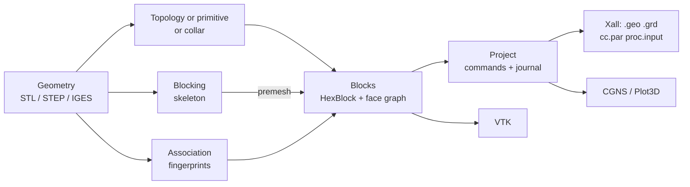

# How SHORE works

SHORE makes structured multi-block grids for overset (Chimera) CFD and
packages them for the Xall/Xnavis solver chain. It has two halves:

1. **Grid generation**: geometry (STL or CAD) in, structured hexahedral
   blocks out. Near-body grids are marched from the wall; junctions get
   collar grids; anything else is blocked by hand, as in ICEM CFD Hexa.
2. **Solver packaging**: the block list out to the files the solver reads:
   `.geo` per block, a `.grd` pack, `cc.par` connectivity with marker boxes
   for hole cutting, and a `proc.input` MPI distribution, with a
   load-balancing split planner. CGNS, Plot3D and VTK cover other solvers
   and viewers.

## The data model

- **Geometry** is reached through one protocol with an STL and a CAD
  backend; entities (surfaces, curves, points) carry fingerprints that
  survive a re-read of an edited file ([Geometry](/concepts/geometry)).
- **Blocks** are `HexBlock`s: a `(ni, nj, nk, 3)` node array with typed
  vertices, edges and faces; faces carry boundary conditions and seams to
  other blocks ([Block model](/concepts/block-model)).
- **Associations** tie block faces, edges and vertices to geometry entities;
  `snap` projects the nodes onto them ([Association](/concepts/association)).
- **The project** applies every change as a command, can undo it, and
  records a journal that replays the grid bit for bit
  ([Projects and journals](/concepts/projects)).
- **Quality** is measured by a fixed set of metrics that the acceptance
  specs are written in ([Grid quality](/concepts/quality)).

## Four ways to make a grid

| Way | What it does | Use it for | Entry points |
|---|---|---|---|
| Marched topologies | project a template onto the body, then extrude layer by layer along the wall normal | near-body grids of star-shaped bodies (cubed sphere, O-grid) and wings (C-grid, CH/OH hybrids with far-field channels) | `shore mesh`, `p.build_topology` + `p.march` |
| Primitives | analytic structured blocks, no geometry | backgrounds, ducts, test grids (box, annulus, flat-caps cylinder, H-grids) | `shore primitive`, `p.build_primitive` |
| Collars | intersection curve of two bodies, a surface grid marched on each, a volume block over the junction | wing–body, appendage–hull junctions in an overset assembly | `shore collar`, `p.build_collar` |
| Interactive blocking | a skeleton of blocks split, O-gridded, associated and premeshed onto the geometry | bodies the templates cannot handle, single-grid junction regions, CAD-driven blocking | `p.create_blocking` … `p.premesh`, the GUI |

The four write the same block model, so the outputs, the quality checks,
the project commands and the GUI work alike on all of them. A Chimera run
usually combines several, each as a project **component**: a body-fitted
grid, a collar, a background box ([Choosing a workflow](/guide/workflows)).

## Concepts

<a class="shore-card" href="/shore/concepts/block-model"><strong>Block model</strong>HexBlock, faces, boundary conditions, axis maps, seams</a>
<a class="shore-card" href="/shore/concepts/geometry"><strong>Geometry</strong>STL and CAD behind one protocol; fingerprints</a>
<a class="shore-card" href="/shore/concepts/association"><strong>Association</strong>block entities linked to geometry, and snapping</a>
<a class="shore-card" href="/shore/concepts/projects"><strong>Projects and journals</strong>commands, undo, replay, save and load</a>
<a class="shore-card" href="/shore/concepts/quality"><strong>Grid quality</strong>the frozen metrics and what the specs require</a>
<a class="shore-card" href="/shore/concepts/near-body-pipeline"><strong>Near-body pipeline</strong>from STL to a marched volume, stage by stage</a>
<a class="shore-card" href="/shore/concepts/projection"><strong>Surface projection</strong>ray casting a template onto the body</a>
<a class="shore-card" href="/shore/concepts/k0-construction"><strong>k=0 construction</strong>the cubed-sphere wall grid: gnomonic caps and seams</a>
<a class="shore-card" href="/shore/concepts/hyperbolic-marching"><strong>Marching schemes</strong>algebraic and hyperbolic layer extrusion</a>
<a class="shore-card" href="/shore/concepts/seam-aware-normals"><strong>Seam-aware normals</strong>centred tangents across block seams</a>
<a class="shore-card" href="/shore/concepts/spacing-laws"><strong>Spacing laws</strong>uniform, tanh, tanh2, geometric, pinned</a>
<a class="shore-card" href="/shore/concepts/pipeline-limits"><strong>Limits</strong>what the marched pipeline does not handle</a>
<a class="shore-card" href="/shore/concepts/topologies/"><strong>Topologies</strong>O-grid, cubed sphere, C-grid, H-grid, hybrids, primitives</a>
<a class="shore-card" href="/shore/concepts/c-grid-construction"><strong>C-grid construction</strong>trailing-edge detection, sections, wake</a>
<a class="shore-card" href="/shore/concepts/airfoil-profiles"><strong>Airfoil profiles</strong>NACA sections and extruded wings</a>
<a class="shore-card" href="/shore/concepts/surface-grids"><strong>Surface grids</strong>TFI and elliptic smoothing on a CAD face</a>
<a class="shore-card" href="/shore/concepts/intersection-curves"><strong>Intersection curves</strong>tracing where two bodies meet</a>
<a class="shore-card" href="/shore/concepts/surface-marching"><strong>Surface marching</strong>hyperbolic grids grown on a surface</a>
<a class="shore-card" href="/shore/concepts/collars"><strong>Collar blocks</strong>volume grids over a junction</a>
<a class="shore-card" href="/shore/concepts/blocking"><strong>Blocking</strong>skeleton, split, O-grid, premesh, wall layers</a>
<a class="shore-card" href="/shore/concepts/chimera"><strong>Chimera grids</strong>overset components and how they connect</a>
<a class="shore-card" href="/shore/concepts/marker-boxes"><strong>Marker boxes</strong>hole-cutting boxes from a body STL</a>
<a class="shore-card" href="/shore/concepts/load-balancing"><strong>Load balancing</strong>splitting blocks across MPI ranks</a>

## See also

- [ADR index](/adr/) and [roadmap](/adr/roadmap): the decisions behind each
  concept, with their measured limits
- [Tutorials](/tutorials/), [Cookbook](/cookbook/), [CLI reference](/reference/),
  [Python API](/reference/api/)
