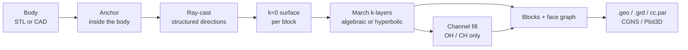

# Near-body pipeline

The near-body pipeline turns a closed body surface (STL, or STEP/IGES/BREP
through `shore[cad]`) into a structured, body-fitted volume grid by
ray-casting a structured surface grid onto the body and extruding it layer
by layer. It is the path behind `shore mesh` and `Project.build_topology` /
`Project.march`. The pages of this section describe each stage independently
of the block layout; the [Topologies](/concepts/topologies/) section
describes how the stages are arranged into blocks.

## Stages

| Stage | Output | Page |
|---|---|---|
| 1. Surface projection | k=0 nodes on the body, one per ray | [Surface projection](/concepts/projection) |
| 2. k=0 construction | the body-conforming surface grid of every block | [k=0 construction](/concepts/k0-construction) (cubed sphere), [C-grid construction](/concepts/c-grid-construction) (wings) |
| 3. Marching | `(ni, nj, nk, 3)` node array per block | [Marching](/concepts/hyperbolic-marching) |
| 4. Seam-aware normals | continuous spacing across block seams at every layer | [Seam-aware normals](/concepts/seam-aware-normals) |

Stages 1 and 2 produce the **k=0 layer**, the wall grid from which the
volume is extruded. Stage 4 is part of stage 3: it changes how normals are
computed on block edges that have a partner block. The
[spacing laws](/concepts/spacing-laws) set the node distribution along
every direction, and the wall-normal step schedule in particular.

The C-grid family does not ray-cast from an anchor: its k=0 layer comes
from slicing the body at span stations ([C-grid
construction](/concepts/c-grid-construction)). Marching and seam handling
are shared.

## Inputs

| Input | Meaning |
|---|---|
| Body | A closed surface. STL is loaded with trimesh; CAD files are tessellated for ray casting and the hits are snapped to the exact surface ([ADR 0002](/adr/0002-geometry-backend)). The ray-cast topologies need a body **star-shaped from the anchor** ([limits](/concepts/pipeline-limits)). |
| Resolution | `ni`, `nj`, `nk` node counts. Under `cubed_sphere`, `nj` is the equator-ring node count and each sub-block gets `nj // 4` cells ([`shore mesh`](/reference/mesh)). |
| Cap angle | `theta_cap`, default $0.05\,\pi$ (9°): the colatitude of the cap corners (cubed sphere) or of the first and last rows (O-grid). OH pins it to $\pi/4$. |
| Spacing | surface i/j laws, wall-normal k law ([Spacing laws](/concepts/spacing-laws)). |
| Marching | `march_scheme` (`algebraic` default, `hyperbolic`), `smooth_mode` (`limited` default, `legacy`) ([Marching](/concepts/hyperbolic-marching)). |

## Outputs

Every topology produces a list of `HexBlock`s with typed faces (`WALL`,
`FREE`, `SHARED`, `DIRICHLET`, ...) and the axis maps of every seam (see
[Block model](/concepts/block-model)). From there SHORE writes one ASCII
`.geo` per block (`<stem>_<label>.geo`; the single-block O-grid writes
`<stem>.geo`), the `.adjacency.json` face graph, and the Xall files (`.grd`,
`cc.par`, `proc.input`), or CGNS and Plot3D ([ADR
0035](/adr/0035-cgns-plot3d-export)). The commands are in the
[reference](/reference/mesh); a worked run is the
[sphere tutorial](/tutorials/sphere).

## Reading order

The stage pages are written to be read in the order of the table: each
assumes the previous ones. [Pipeline limits](/concepts/pipeline-limits)
lists what the pipeline cannot do and where the other tools of SHORE
(collars, blocking) take over.

## See also

- [Topologies](/concepts/topologies/): the block layouts built from these stages
- [Pipeline limits](/concepts/pipeline-limits)
- [Chimera mesh generation](/concepts/chimera): where near-body grids fit in an overset assembly
- [`shore mesh`](/reference/mesh), [Sphere tutorial](/tutorials/sphere), [Wing tutorial](/tutorials/wing)
