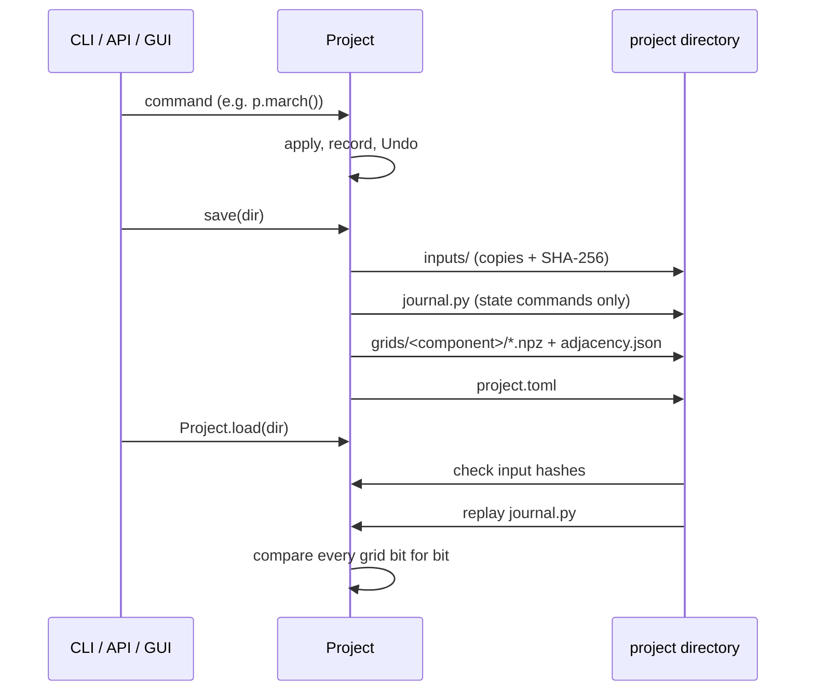

# Projects and journals

A `Project` is the stateful document behind every way of driving SHORE: the
Python API, the CLI and the GUI. Every change to it is a **command**; the
project keeps the commands it applied, can undo and redo them, and writes
them out as a **journal**, a plain Python script that rebuilds the same grid
bit for bit. This is the model of Pointwise's Glyph, ICEM's replay files and
Cubit's journals ([ADR 0004](/adr/0004-command-layer)): a grid is
reproducible, scriptable and testable because every action is a recorded
command.

## What a project holds

- **Named geometries** (`p.geometries`): each loaded with
  `p.load_geometry(path, name="body")`, STL or CAD. Reloading a name
  replaces the geometry and discards the meshes of the components built on
  it.
- **Named components** (`p.components`): each a mesh (a list of blocks)
  with its build state, and for interactive work a blocking. One component is
  current (`p.use_component(name)`, default `"main"`); every mesh command
  acts on it, and `p.mesh` / `p.build` / `p.blocking` are the current
  component's. Components are the Chimera components of one Xall run: a
  body-fitted grid, a collar, a background
  ([ADR 0016](/adr/0016-multi-component-projects)).
- **The history**: the applied commands with their undo records, and the
  redo stack.

## Commands

A command is a frozen dataclass (`shore.project.commands`). Each
`Project` method builds one and executes it:

| Member | Role |
|---|---|
| `apply(project, ctx) -> Undo \| None` | changes the project; returns how to revert it |
| `to_source()` | the one line of public API that re-issues it: `p.march(march_scheme='hyperbolic')` |
| `method` | the `Project` method name used in that line |
| `mutates` | `False` for output-only commands (`write_*`), which are never undone |
| `inputs` | the fields that hold input file paths (copied on save) |

`Undo` holds a `restore` function. Cheap commands (an association, a
component switch) capture the previous value. Commands that rewrite node
arrays (`march`, `snap`, `redistribute`, …) snapshot every block's nodes to
`.npz` files in an on-disk `UndoCache`, never in RAM (a $10^7$-node grid is
240 MB), and restore them in place so seam views stay aliased. A command
that fails or is cancelled restores the state and is not recorded. Long
commands take a `progress(fraction, message)` callback and a `CancelToken`
checked once per layer or sweep; the GUI runs them on a worker thread.

`undo()` reverts the last state-changing command, dropping any output
commands after it from the history; `redo()` re-applies it.

The command set covers the whole tool: geometry and components
(`load_geometry`, `use_component`), grid building (`build_topology`,
`march`, `build_primitive`, `build_tip_cap`, `build_collar`, `load_blocks`,
`split`), geometry links (`associate`, `snap`, `surface_grid`,
`redistribute`), blocking (`create_blocking`, `split_blocking`, `ogrid`,
`move_vertex`, `delete_blocks`, `associate_blocking`, `premesh`,
`orthogonalize`, `wall_layer`) and outputs (`write_geo`, `write_adjacency`,
`write_grd`, `write_cc_par`, `write_proc_input`, `write_xall`,
`write_cgns`, `write_plot3d`). The [project scripts reference](/reference/run)
lists their arguments.

## The journal

```python
from pathlib import Path

from shore.project import Project
from shore.shapes import sphere

sphere(radius=1.0, subdivisions=3).export("ball.stl")

p = Project()
p.load_geometry("ball.stl")  # geometry "body", component "main"
p.build_topology("ogrid", nk=9, ds=0.01, growth=1.2, ni=17, nj=24)
p.march()
p.use_component("background")
p.build_primitive("box", vmin=(-3, -3, -3), vmax=(3, 3, 3), ni=13, nj=13, nk=13)
p.undo()  # the box is gone; the component switch stays
p.redo()
p.save("ball.shore")

print(Path("ball.shore/journal.py").read_text())
q = Project.load("ball.shore")  # replays the journal, checks every grid bit for bit
r = Project.load("ball.shore", replay=False)  # grids and face graphs read back
print(sorted(q.components), sorted(r.components))  # ['background', 'main'] twice
```

`p.journal()` returns the history as a script and `p.save_journal(path)`
writes it. The script above prints the saved project's `journal.py`: the
same history, with the input path rewritten to the project's copy and the
undone-then-redone box recorded once. A journal is the script a user would
have typed:

```python
# ball.shore/journal.py
# SHORE journal: replay with `shore run <this file>`.
from shore.project import Project

p = Project()
p.load_geometry('inputs/00_ball.stl')
p.build_topology('ogrid', nk=9, ds=0.01, growth=1.2, ni=17, nj=24)
p.march()
p.use_component('background')
p.build_primitive('box', vmin=(-3, -3, -3), vmax=(3, 3, 3), ni=13, nj=13, nk=13)
```

Each line names only the arguments that differ from their defaults.
`shore run journal.py` (or `run_journal(path)`) executes it and returns the
project named `p`; `--save-project DIR` also saves it. Because it is Python,
a journal can be edited, parameterised and looped over, and must only be run
when trusted.

**Determinism.** Replaying a journal on the same inputs gives bit-identical
grids and byte-identical `.geo`, `.grd` and `cc.par` (numpy is reproducible
for a fixed operation order on one machine). This is tested on every saved
project load. Replaying it on an *edited* geometry regenerates the grid for
the new shape; associations re-find their entities
([Association](/concepts/association)).

## Saving and loading



`p.save(dir)` writes a directory (format 3; formats 1 and 2 still load):

```text
project.toml                       format, SHORE version, components and their
                                   block labels, SHA-256 of every input copy
journal.py                         the state-changing history, reading inputs/
inputs/NN_<name>                   a copy of every file the journal reads
adjacency.json                     the current component's face graph
grids/<component>/NNNN.npz         node arrays, one per block
grids/<component>/adjacency.json   each component's face graph
```

- **Portable.** Every file the journal reads is copied once into `inputs/`
  and the saved journal reads the copies. A project directory can be moved,
  and the original inputs deleted.
- **Outputs are dropped.** Output commands never change state, and on load
  they would write wherever the journal says, so the saved journal keeps
  only state-changing commands. `journal()` still returns the full history.
- **`Project.load(dir)`** checks the input copies against their hashes
  (`MeshInputError` on a missing or changed copy), replays `journal.py` with
  the inputs resolved against the directory, and requires every grid to be
  bit-identical to the saved one. A load is therefore also a determinism
  check, and costs as much as a rebuild.
- **`Project.load(dir, replay=False)`**
  ([ADR 0033](/adr/0033-load-without-replay)) checks the hashes, *records*
  the journal (only `load_geometry` and `use_component` are applied), and
  reads each component's blocks from its grids, rewired from its face graph.
  It takes a fraction of a second. The loaded meshes cannot be marched again
  (their build state is `"blocks"`), the loaded history cannot be undone,
  blockings are not restored, and the grids are not re-checked. A project
  saved before the per-component face graphs existed must be loaded with
  replay and saved once first.

## Components and the Xall run

One project is one Xall run. `p.write_xall(directory, grd=..., np=...)`
writes each component's `.geo` files, sidecar, `.grd` and `cc.par`, then the
merged `.grd` and `cc.par` and one `proc.input` balanced over the merged
`.grd`. Header options (`output_basename`, `multigrid_levels`,
`boundary_layer_thickness`, `numerical_beach`) are run-wide; block options
(`free_face_bc`, `meta`, `boxes`, `body`, `proc_meta`) are per component
([ADR 0017](/adr/0017-xall-options-per-component)). `write_cgns` and
`write_plot3d` write every component, or the ones named, to one file: one
CGNS base per component ([ADR 0035](/adr/0035-cgns-plot3d-export)).

## The CLI over projects

The CLI commands are thin wrappers over commands
([ADR 0018](/adr/0018-cli-collars-and-projects)):

| Option / command | Effect |
|---|---|
| `--journal FILE` on `mesh`, `primitive *`, `cap-tip`, `split`, `grd`, `cc-par`, `proc-input` | also write the run as a journal |
| `--project DIR [--component C]` on `mesh`, `collar`, `primitive *` | load the project (created if missing), build component `C`, save it |
| `--geometry-name` on `mesh` | the geometry's name in the project (default: the file stem) |
| `--no-replay` | open `--project` without replay |
| `shore run JOURNAL [--save-project DIR]` | replay a journal |
| `shore xall DIR --out RUN [--options xall.toml]` | write the Xall run of a saved project |
| `shore cgns DIR -o FILE`, `shore plot3d DIR -o FILE` (`-c` per component) | export a saved project |

Editing a project from the CLI is load, apply, save: each call replays the
existing components once (unless `--no-replay`). A geometry already loaded
under a name from a file with the same SHA-256 is reused, not reloaded, so
two collars on the same files can share a project; a name collision with a
different file is an error. Parameter precedence on every command is:
explicit flag, then `--config` TOML, then the built-in default.

The commands that only inspect files or span several runs (`*-merge`,
`balance`, `boxes-*`, `body`, `profile`, `info`, `check`, `export`, `view`)
stay file tools outside projects.

## Limits

- A mesh after `split`, `load_blocks`, `build_primitive`, `build_tip_cap`, a
  collar or `premesh` is not marchable: the marchers dispatch on a
  topology's original block layout.
- Determinism holds on one machine and numpy build; across platforms,
  round-off may differ and a replayed load may then refuse the saved grids.
- A journal is executed as Python: run only journals you trust.

## See also

- [ADR 0004](/adr/0004-command-layer), [ADR 0016](/adr/0016-multi-component-projects),
  [ADR 0017](/adr/0017-xall-options-per-component),
  [ADR 0018](/adr/0018-cli-collars-and-projects), [ADR 0033](/adr/0033-load-without-replay)
- API: [`Project`](/reference/api/shore.project.project#Project),
  [`run_journal`](/reference/api/shore.project.project#run_journal),
  [`Command`](/reference/api/shore.project.commands#Command)
- [Projects and replay](/tutorials/projects), [Save, load, replay](/cookbook/projects),
  [Multi-component Xall run](/cookbook/multi-component)
- Reference: [Project scripts](/reference/run), [`shore run`](/reference/run),
  [`shore xall`](/reference/xall), [`shore cgns`](/reference/cgns), [GUI](/reference/gui)
