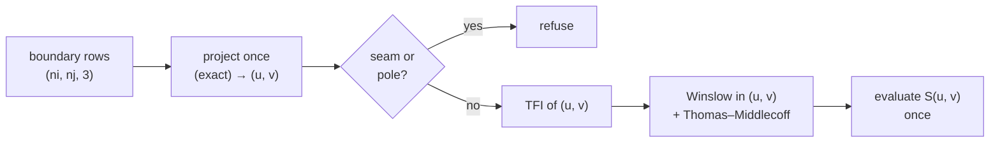

# Surface grids on a CAD face

A surface grid fills one block face from its four boundary rows, with every
node on a parametric CAD surface. It is the face-filling step of a
CAD-driven workflow, as in ICEM CFD or Pointwise: the edges are fixed
first (on CAD curves, or by a topology), and the face is meshed on the
surface between them. SHORE does it with transfinite interpolation (TFI)
in the surface's parameter plane, followed by elliptic (Winslow) smoothing
in the same plane, and evaluates the surface once at the end.

The kernel is `shore.surface.tfi.surface_grid`; the journaled command is
`Project.surface_grid` (`FillFace`), which rebuilds one face of a mesh
block in place.

## Why the parameter plane

The obvious alternative, TFI of the physical boundary points followed by
a projection onto the surface, interpolates along chords that cut through
a curved surface. On a cylinder patch with a distorted parametrisation,
physical TFI is off by 0.046 where TFI in $(u, v)$ is exact to $10^{-15}$.

Smoothing on the surface with a re-projection every sweep is the other
alternative. At the measured tier-1 projection rate of
$2.5 \cdot 10^4$–$1.3 \cdot 10^5$ points/s, $10^5$ nodes and 100 sweeps
cost about 100 s per face. Working in $(u, v)$ bounds the geometry work
per node instead of per sweep.

## The method



1. **Boundary parameters.** The four boundary rows are projected once onto
   the SURFACE entity (tier-2, exact projection), which gives their
   $(u, v)$. Boundary nodes farther than $10^{-6}$ of the model diagonal
   from the surface are refused.
2. **TFI** of those parameters: a Coons patch in $(u, v)$.
3. **Winslow smoothing** in $(u, v)$ (with `smoothing="elliptic"`, the
   default). With $\mathbf r = (u, v)$ and $\mathbf S(u, v)$ the surface,
   the physical tangents are $\mathbf x_\xi = \mathbf S_u u_\xi +
   \mathbf S_v v_\xi$ (likewise $\mathbf x_\eta$), and the solved system is

   $$
   \alpha\,(\mathbf r_{\xi\xi} + P\,\mathbf r_\xi)
   - 2\beta\,\mathbf r_{\xi\eta}
   + \gamma\,(\mathbf r_{\eta\eta} + Q\,\mathbf r_\eta)
   + \mathbf c = 0,
   \qquad
   \alpha = |\mathbf x_\eta|^2,\;
   \beta = \mathbf x_\xi \cdot \mathbf x_\eta,\;
   \gamma = |\mathbf x_\xi|^2 .
   $$

   The term $\mathbf c$ carries the parametrisation's second derivatives
   (the Christoffel terms):

   $$
   \mathbf c = G^{-1}
   \begin{pmatrix} \mathbf S_u \cdot \mathbf w \\ \mathbf S_v \cdot \mathbf w \end{pmatrix},
   \qquad
   \mathbf w = \alpha\,S(\mathbf r_\xi, \mathbf r_\xi)
   - 2\beta\,S(\mathbf r_\xi, \mathbf r_\eta)
   + \gamma\,S(\mathbf r_\eta, \mathbf r_\eta),
   $$

   with $G$ the first fundamental form and $S(\mathbf p, \mathbf q) =
   \mathbf S_{uu} p_u q_u + \mathbf S_{uv}(p_u q_v + p_v q_u) +
   \mathbf S_{vv} p_v q_v$. These are the physical Winslow equations
   projected on the tangent plane, so the result does not depend on how
   the CAD face happens to be parametrised.
4. **One evaluation** of $\mathbf S$ at the final $(u, v)$. The boundary
   rows of the result are the input rows, bit for bit.

### Control functions: keeping the clustering

Plain Winslow equalises the grid and washes out wall clustering: on a
clustered rectangle (first cell $8 \cdot 10^{-4}$) the first cell grows
1.7–13× and nodes move by up to 33 local spacings. SHORE adds
Thomas–Middlecoff control functions taken from the physical boundary,

$$
P = -\frac{\mathbf x_\xi \cdot \mathbf x_{\xi\xi}}{|\mathbf x_\xi|^2}
\quad\text{on the two } j\text{-boundaries},
\qquad
Q = -\frac{\mathbf x_\eta \cdot \mathbf x_{\eta\eta}}{|\mathbf x_\eta|^2}
\quad\text{on the two } i\text{-boundaries},
$$

blended linearly across the face and clipped to $|P|, |Q| \le 1.5$ (which
keeps the five-point operator an M-matrix). On tensor-product boundary
data they make the TFI grid an exact solution, so the clustering of the
boundary is kept: on the clustered rectangle the first cell comes out at
1.00000 of the boundary's.

### Solver and work

The metric ($\mathbf S_u, \mathbf S_v$ and the three second derivatives)
comes from a parameter lattice evaluated once, twice the grid's resolution
in each direction, and is interpolated bilinearly. The nonlinear system is
solved by Picard iteration with one SuperLU factorisation per outer step,
shared by $u$ and $v$, so the result is deterministic. Measured work:
5.2 geometry points per grid node, independent of the number of
iterations.

## Parameters

`EllipticParams` holds the smoother's defaults; they are not per-case
tuning knobs.

| Field | Default | Meaning |
|---|---|---|
| `lattice_refine` | 2 | metric lattice spacing = grid parameter spacing / refine |
| `max_iterations` | 400 | Picard steps |
| `tolerance` | 1e-12 | largest parameter update, relative to the $(u, v)$ extent |
| `control_limit` | 1.5 | bound on $\lvert P \rvert$, $\lvert Q \rvert$ |

The user-facing choice is `smoothing`: `"elliptic"` (default) or `"none"`
(plain TFI in $(u, v)$).

## Measured behaviour

From the frozen acceptance spec (`tests/spec/test_surface_tfi.py`), on
exact analytic surfaces:

| Case | Result |
|---|---|
| uniform physical boundaries, distorted plane / cylinder | 0.0007 h / 0.0011 h from the uniform grid (TFI: 0.65 h, 1.03 h) |
| tanh-clustered rectangle | first cell 1.00000 of the boundary's |
| S-shaped overhang, 81 × 61 | TFI folds 29 cells; elliptic 0 folded, minimum corner angle 5.4° |
| sphere patch | 0 folded; minimum corner angle 68° (lat-lon TFI: 88°) |

On a STEP cylinder, the rebuilt inner face of a clustered annulus sector
lies $7.7 \cdot 10^{-4}$ local spacings from the exact tensor face and
$2.2 \cdot 10^{-16}$ from the CAD surface, in 0.01 s.

Winslow equalises; it does not preserve angles. On the sphere patch it
lowers the minimum corner angle from TFI's 88° to 68°. Only validity is
required there.

## The command

`Project.surface_grid(block, face, *, surface, smoothing="elliptic",
geometry="body")` checks the block, the face name and the SURFACE index,
runs the kernel on the face's node view, and only then snapshots the mesh,
so a refused call leaves no undo entry and the nodes untouched. The result
is written through the view, so a SHARED face aliased by another block
stays consistent. The rest of the block does not move.

```python
import build123d as bd
import numpy as np

from shore.geometry import BODY
from shore.project import Project

bd.export_step(bd.Cylinder(radius=0.5, height=4.0), "cylinder.step")

p = Project()
p.load_geometry("cylinder.step")
p.build_primitive(
    "annulus", r_in=0.5, r_out=1.5, z0=-1.5, z1=1.5, ni=9, nj=25, nk=21,
    theta_start=0.5, theta_end=2.0, j_law="tanh2", j_beta=2.0,
)
probe = np.array([0.5 * np.cos(1.25), 0.5 * np.sin(1.25), 0.0])
face = int(p.body.geometry.project(probe, BODY).entity_index)  # the cylinder's SURFACE
p.surface_grid(p.mesh.blocks[0].label, "i_lo", surface=face)  # TFI + Winslow in (u, v)
print(p.journal().splitlines()[-1])  # p.surface_grid('annulus', 'i_lo', surface=0)
```

This needs the CAD extra (`shore[cad]`).

## Limits

- **CAD only.** An STL has no $(u, v)$ parametrisation; the command refuses
  it.
- **Periodic seams.** A face whose boundary crosses the surface's periodic
  seam (a full cylinder or sphere band) is refused: around the boundary,
  a parameter step per unit length more than 50× the median marks the
  jump of a whole period. Split the face at the seam.
- **Singular points.** A face with a collapsed boundary edge (coincident
  consecutive nodes, as at a pole or a cone apex) is refused.
- **One CAD face per block face.** Block faces spanning several CAD faces
  are out of scope.
- **No orthogonality control** at the boundary (Sorenson / Hilgenstock).
- **Clustered boundaries on strongly concave boundaries.** The
  Thomas–Middlecoff functions copy irregular boundary spacing and can fold
  the grid there. Boundaries spaced evenly in arc length do not trigger it.

## See also

- [ADR 0007 — Surface grids](/adr/0007-surface-grids): the decision, the
  acceptance numbers and the review decisions.
- [ADR 0002 — Geometry backend](/adr/0002-geometry-backend): the two
  projection tiers.
- [`shore.surface.tfi`](/reference/api/shore.surface.tfi) —
  [`surface_grid`](/reference/api/shore.surface.tfi#surface_grid),
  [`EllipticParams`](/reference/api/shore.surface.tfi#EllipticParams).
- [`Project.surface_grid`](/reference/api/shore.project.project#Project-surface_grid)
  and the command [`FillFace`](/reference/api/shore.project.commands#FillFace).
- [Fill a block face on a CAD surface](/cookbook/cad-face) (recipe).
- [Geometry](/concepts/geometry) and [Association](/concepts/association).
