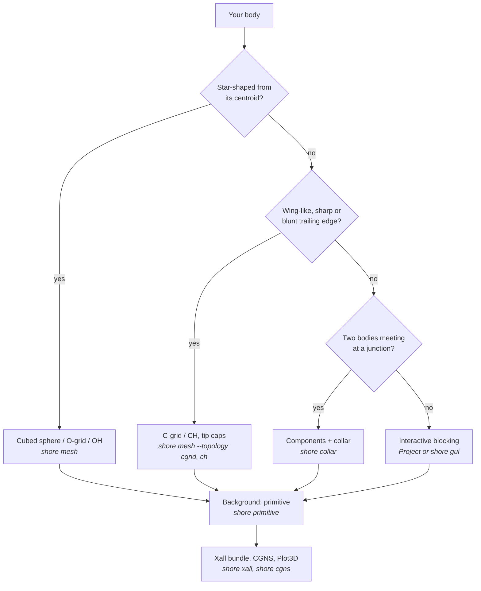

# Choosing a workflow

SHORE has four ways to make a grid. They share the geometry, the block
model, the project journal and the outputs, so one overset case can mix
them: a marched grid per component, collars at the junctions, a primitive
background.

| Workflow | Input | Effort | Grid | Read |
|---|---|---|---|---|
| **Marched topology** | closed STL or CAD body | one command | near-body, overset | [tutorial 1](/tutorials/sphere), [tutorial 2](/tutorials/wing), [topologies](/concepts/topologies/) |
| **Primitive** | dimensions only | one command | background, duct | [primitives](/concepts/topologies/primitives) |
| **Collar** | two intersecting bodies | one command, a seed point | junction, overset | [tutorial 5](/tutorials/collar), [collars](/concepts/collars) |
| **Blocking** | STL or CAD, any shape | interactive: tens of commands, scriptable | point-matched multi-block | [tutorial 7](/tutorials/blocking), [tutorial 8](/tutorials/gui), [blocking](/concepts/blocking) |

## Which interface

- **CLI** (`shore mesh`, `shore collar`, `shore primitive`, `shore xall`
  …) for the one-command workflows and the solver files. Add
  `--journal j.py` to keep the script, `--project DIR --component C` to
  build a multi-component project one command at a time.
- **Python** (`shore.project.Project`) for anything scripted, parametric
  or blocked: each method is one command, the history is the journal.
- **GUI** (`shore gui`, extra `gui`) for blocking and associations, where
  you pick edges, faces and geometry with the mouse. It writes the same
  journal, so the session replays headless.

## Rules of thumb

- Start marched. A cubed sphere or a C-grid is minutes of work; block only
  what no topology fits.
- Keep components separate in overset cases and let the solver do the
  hole cutting; point-matched blocking is for when you need one conforming
  grid.
- Put the geometry in CAD when you can: exact projection and fingerprinted
  entities make the journal survive design changes
  ([geometry](/concepts/geometry)).
- Check before you ship: [grid quality](/cookbook/quality).
