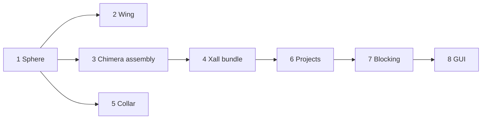

# Tutorials

Eight tutorials, each one story from an empty directory to a finished
result. Every step shows real commands and real output; every Python snippet
is a region of a script under
[`examples/tutorials/`](https://github.com/szaghi/shore/tree/main/examples/tutorials)
that runs to the end in under a minute. Run them in order the first time:
each assumes what the earlier ones taught.

<a class="shore-card" href="/shore/tutorials/sphere"><strong>1. A sphere, end to end</strong>STL to a checked cubed-sphere grid: wall spacing, quality metrics, the hyperbolic scheme, VTK export, journal replay.</a>
<a class="shore-card" href="/shore/tutorials/wing"><strong>2. A wing with a C-grid</strong>NACA 0012 section and wing, C-grid with wake branches, sharp and blunt trailing edges, tip caps, CH far-field box.</a>
<a class="shore-card" href="/shore/tutorials/chimera-assembly"><strong>3. A Chimera assembly</strong>A near-body grid inside a background grid, kept as two components of one project; checking the overlap.</a>
<a class="shore-card" href="/shore/tutorials/xall-bundle"><strong>4. The Xall bundle</strong>Marker boxes, .grd, cc.par and proc.input: in one shore xall call and file by file.</a>
<a class="shore-card" href="/shore/tutorials/collar"><strong>5. Collar at a junction</strong>Full, half, clustered and split collars where two bodies meet.</a>
<a class="shore-card" href="/shore/tutorials/projects"><strong>6. Projects and replay</strong>Components, undo and redo, save and load, replay a journal on an edited input.</a>
<a class="shore-card" href="/shore/tutorials/blocking"><strong>7. Blocking a wing–body</strong>A multi-block grid from an empty box on a CAD wing–body: splits, O-grid, association, premesh, wall layer.</a>
<a class="shore-card" href="/shore/tutorials/gui"><strong>8. The same in the GUI</strong>Tutorial 7 with the mouse; the saved session replays headless to the same grid.</a>

## What each one needs

| Tutorial | Extras | Script run time | What it builds on |
|---|---|---|---|
| [1. A sphere, end to end](/tutorials/sphere) | none (`vis` for the VTK export) | ~3 s | nothing |
| [2. A wing with a C-grid](/tutorials/wing) | none (`vis` for the VTK export) | ~2 s | 1 |
| [3. A Chimera assembly](/tutorials/chimera-assembly) | none (`vis` for the VTK export) | ~2 s | 1 |
| [4. The Xall bundle](/tutorials/xall-bundle) | none (`vis` for `boxes-export`) | ~7 s | 3 |
| [5. Collar at a junction](/tutorials/collar) | none | ~20 s | 1 |
| [6. Projects and replay](/tutorials/projects) | `cgns` | ~2 s | 1, 4 |
| [7. Blocking a wing–body](/tutorials/blocking) | `cad`, `cgns` | ~10 s | 6 |
| [8. The same in the GUI](/tutorials/gui) | `gui`, `cad` | interactive | 7 |

Install the extras with pip, e.g. `pip install "shore-mesh[vis,cgns,cad]"`;
see [Installation](/guide/installation). The GUI needs a GPU driver with
Metal, Direct3D 12 or Vulkan.

## Suggested order

- **Near-body grids by marching**: 1, then 2 for lifting surfaces.
- **A solver-ready overset run**: 1, 3, 4.
- **Junctions between bodies**: 1, then 5.
- **Interactive multi-block grids on CAD**: 6, 7, then 8.

For a single task without the story, see the [Cookbook](/cookbook/); for
how the algorithms work, the [Concepts](/concepts/).
